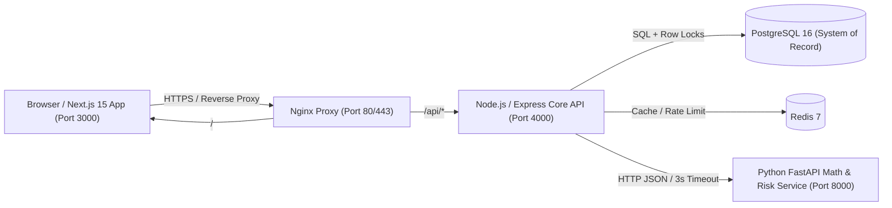
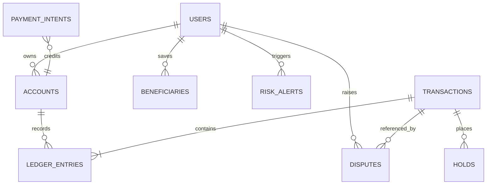

# FinCore Architecture & Data Model

## 1. System Architecture

## 2. Service Boundaries & Data Ownership

- **PostgreSQL (`database/migrations/`)**: Single system of record for users, accounts, transactions, immutable `ledger_entries`, holds, payment intents, webhook events, settlements, disputes, risk alerts, notifications, and immutable `audit_logs`.
- **Core API (`apps/api`)**: Owns authentication, RBAC (5 roles), input validation, idempotency, double-entry transfer consistency, webhook HMAC verification, and audit trail recording.
- **Analytics & Math Service (`apps/analytics`)**: Stateless Python/FastAPI service owning exact `Decimal` fee/interest/statement/reconciliation math and decision-support velocity/risk scoring.
- **Frontend (`apps/web`)**: Next.js App Router UI with Redux Toolkit state management. Never trusted for security or balance enforcement.

## 3. Concurrency Control & Ledger Invariants

- **Pessimistic Row-Level Locking**: `ledgerService.ts` locks all involved `accounts` rows using `SELECT ... FOR UPDATE` inside a PostgreSQL transaction.
- **Deadlock Prevention**: Account UUIDs are sorted lexicographically before acquiring `FOR UPDATE` locks, guaranteeing a consistent global lock acquisition order across concurrent transfers.
- **Idempotency**: Every mutating financial endpoint requires an `Idempotency-Key` header enforced by a `UNIQUE` constraint on `transactions.idempotency_key` and checked inside the transaction.
- **Database-Level Invariants**:
  - `chk_wallet_non_negative` prevents negative wallet balances.
  - `trg_ledger_entries_immutable` & `trg_audit_logs_immutable` block `UPDATE` and `DELETE`.
  - `assert_transaction_balanced(tx_id)` verifies `SUM(DEBIT) == SUM(CREDIT)` before commit.

## 4. Database ER Diagram

